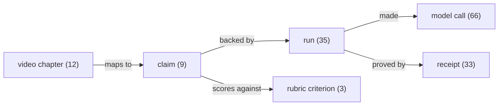

# Judging index

Pointers only. Every number below resolves in the Proof Graph
(`agenthand evidence verify --all`, `agenthand evidence trace <id>`)
or in the frozen replay under `conformance/`.

The graph above is rendered from the shipped Proof Graph
(`agenthand evidence graph --format mermaid` prints the full
202-edge version): every claim in the film and the README traces
through runs and calls to a receipt a judge can re-verify offline.

## Impact

- The problem surface: agents that stage, price, and document real
  rooms, objects, and property — listing photos, bid packets, room
  records. README, opening sections.
- The dispute case: a staged photo a buyer can challenge is answered
  by a receipt, not an argument. Film chapters 0–2; trace any of
  them. `agenthand evidence trace chapter:3`
- Pricing from real local listings (asking prices, stated as such):
  the identify result's pricing block; method in the README.

## Use of Meta AI Tooling

- Every runtime model is a Meta model; the full call table is in
  the Proof Graph (`calls`: tool, model, settled cost per run).
- identify = Muse Spark 1.3; cut_out = SAM 3.1; draw plate =
  Muse Image 1.0; narration = Muse Spark Open via Baseten.
- Spend discipline is in the product: every call is budgeted
  before it runs; an over-cap settle is recorded as over_cap and
  later calls refuse. Film chapter 7; the ledgers are run data in
  the Proof Graph.

## Demo

- The film's chapters, timestamps, and narration lines are rows in
  the Proof Graph (`video_chapters`), each mapped to the claim and
  the run behind it. Any second of the film traces to a receipt.
- The hero run in the film is a real run on the shipped build
  (v109, two-zone): proof core 4,053,953 product pixels checked,
  0 changed, verify PASS. The repair margin is rebuilt and
  counted, never claimed as original: 381,802 pixels, of which
  278,417 are real photo pixels.
  `agenthand evidence trace claim:9`
- The screen recording in chapter 8 is the same tool running live,
  uncut, on a second real run (its own receipt; the two runs are
  never mixed in one claim).

## Technical Depth & Execution

- The Proof Graph itself is knowledge graph engineering applied
  to build evidence: runs, calls, receipts, claims, and film
  chapters in one rusqlite store inside the Rust product; graph
  edges are derived from the tables' foreign keys at import, so
  the graph cannot disagree with the data. `evidence/schema.sql`;
  `agenthand evidence graph`.
- Fidelity Lock: the composite is deterministic and code-side; the
  model only ever paints the background plate. A one-pixel tamper
  in a shipped output fails verification (try it on the replay).
- Dual build, cross-verified: Rust is the product, Python is the
  reference implementation and test oracle; the parity harness in
  `conformance/` runs both against the same cases.
- Test suites at submission: Rust 416 passed / 0 failed (11
  ignored); Python 648 passed / 0 failed. Receipt verification
  speed, both shipped CLIs on the frozen replay images, 23
  interleaved rounds on one machine: Rust about 10.5x faster
  (median of per-round ratios; Rust won all 23 rounds).
- The measurement estimator refuses rather than guesses: a
  strict-recheck gate and a scenery guard were added after an
  adversarial catch (a fence photo produced a phantom card fit);
  the two-sided fixtures are in the repo history and the claim
  ledger.

## From the film to the proof (deep links)

Every moment of the demo resolves in the Proof Graph. Give the CLI a
film timestamp and it names the chapter and the claim behind it:
`agenthand evidence chapter 1:42`. The claimed segments:

| Film time | Segment | Claim | Check it |
|---|---|---|---|
| 0:00 to 0:14 | Ch0 baseline, suitcase | 5 | `agenthand evidence verify 5` |
| 0:37 to 0:51 | Ch2 hero run | 9 | `agenthand evidence verify 9` |
| 1:36 to 1:50 | Ch5 open-house fill | 4 | `agenthand evidence verify 4` |
| 2:05 to 2:20 | Ch7 parity | 2 | `agenthand evidence verify 2` |
| 2:20 to 2:35 | Ch8 recorded take | 3 | `agenthand evidence verify 3` |

Chapters with no claim behind them resolve to no claim, by design;
nothing in the film is mapped to evidence it does not have. The
caption track (evidence/caption-track.vtt in the repo) carries the
same claim ids at the same timestamps. One command re-checks the
whole graph: `agenthand evidence verify --all`. A ready-made copy of
the full evidence set (database, receipt files, manifest) exports
with `agenthand evidence export <dir>`.

## A note on reading the Proof Graph

Variant draws (same item, several backgrounds) repeat their shared
identify and cut_out calls per variant row. For spend, use run
totals (`runs.total_settled_usd`); a naive sum over all calls
double-counts the shared chains.
