# agenthand — Rust build

[](https://github.com/AUsernameForYou/agenthand-rust/actions/workflows/ci.yml)

agenthand is an MCP server for AI agents that help people sell things.
The seller never opens it; their agent calls it. It turns messy product
photos into listing-ready images, with a fidelity receipt on every
staged shot.

This repository is the **Rust build**, the public submission build of
agenthand: one static binary, no Python runtime. The Python build
([AUsernameForYou/agenthand](https://github.com/AUsernameForYou/agenthand),
also on PyPI as `agenthand`) remains available as the fallback install
and is the reference implementation this port is measured against.

**Demo film:** _link lands here at the reveal (submissions close
Nov 4, 2026)._
**Verify a staged image in your browser:**
https://ausernameforyou.github.io/agenthand/#fidelity
**Project site:** https://ausernameforyou.github.io/agenthand/

**Submission freeze:** the submitted build is the one tagged
`v1.0.0-hackathon` in this repository. If you are reading this on a
later `main`, the tag is the exact code the judges were given.

## The problem

A staged listing photo sells the item, and it creates a trust
problem. Generative photo tools rebuild the product from scratch, so
details drift and flaws can quietly vanish. When a buyer says "you
hid the scratch," the seller has no answer. As of October 22, 2026,
most Etsy listings must include at least one unedited photo of the
actual item against a real background; AI-assisted images are
allowed only as supplements and must accurately represent the item.
Staging is fine. Proof is the missing piece.

## The three tools

- **identify** — reads a product photo and returns a description, a
  cut-out-ready concept, and listing copy (title, bullets, condition).
- **cut_out** — segments the product with SAM 3.1 and stores a
  transparent foreground PNG plus mask, with file and pixel hashes
  recorded for lineage.
- **draw** — Fidelity Lock staging. The stored product layer is never
  regenerated: the model generates only the background plate and
  deterministic code composites the original pixels over it. Every
  staged image ships with a receipt, and an independent verifier can
  recount the product pixels from disk and prove none changed.

**Pricing.** An ok identify result also carries a `pricing` block,
computed in code after identify returns (the identify prompt and
schema are unchanged): a range of possible asking prices, a
recommended price (the comps median), the 25th to 75th percentile
band and a confidence, from the comps category the item matches in a
local comps file (`AGENTHAND_COMPS_FILE`, default
`pricing-comps.json` in the data dir). There is no separate pricing
tool. Local comps price first (`scope: "local"`); a category with no
local comps uses its wider-area tier and says so (`scope: "wide"`,
"No local items found; priced from wider-area listings."). Prices are
asking prices from Facebook Marketplace comps and are advisory; an
item with no matching category, or no comps file, returns
`{"status": "no_comps"}`.

One operator key, `META_API_KEY`, covers all model calls. The server
starts and lists its tools without one; the key is required when a
tool makes a model call. Every billable call passes a single choke
point with a fail-closed spend cap.

## The room run

The three tools also compose into a room run (`agenthand room-run`):
the seller walks a room with photos, video, or a narrated
walkthrough, names what goes, and gets one staged listing per item,
each with its own Fidelity Lock receipt, its own listing copy, and a
backdrop chosen per run (a generated scene, a white wallpaper plate
with the agenthand mark, or studio gray). A mention the photos
cannot support fails honestly as NO_MATCH instead of becoming a
listing. When the calling agent supplies market comps, the run also
emits a priced table (suggested prices are recommendations, never
orders). On October 28, 2026, a room run over Daniel's real room
staged six distinct items with 352,597 product pixels checked across
them and 0 changed, for $0.154487 in settled Meta calls (including a same-day re-cut of one hat).

## Built with Meta AI

| Tool | Model | Its job |
|---|---|---|
| identify | Muse Spark 1.3 | Reads the photo, plans the cut, writes the listing copy |
| cut_out | SAM 3.1 | Draws the product mask |
| draw | Muse Image 1.0 | Generates the background plate only |

## Open weight: Muse Spark Open on Baseten

Narration runs on an open-weight Meta model. When a room run is
driven by a narrated walkthrough, the audio goes to **Muse Spark
Open** (`meta-models/muse-spark-open-1026`) served through Baseten
partner inference, which returns the transcript and the sale intent
(which items are for sale, which are only mentioned) in one call.
That split drives the run: named items stage, mentioned items stage
only when the photos confirm them, and unsupported mentions fail as
NO_MATCH. The narration runs on Baseten partner credits, a pool
separate from the Meta Model API spend cap; the three tools
themselves run on the hosted Meta models in the table above.

## Architecture

One binary, two halves: a library crate where all the policy lives,
and a thin `main.rs` with seven subcommands (`serve`, `parity`,
`verify`, `measure`, `heic-extract`, `room-run`, `evidence`). The MCP server is
a hand-rolled JSON-RPC stdio loop; each tool handler is a thin edge
that ingests, calls one policy function, and shapes the result JSON.

| Module | What it owns |
|---|---|
| `server` | The stdio loop and the three tool handlers |
| `meta` | Meta Model API client: identify and draw contracts, bounded retries |
| `sam`, `segmentation` | SAM 3.1 mask wire format; mask quality gates and the recovery loop |
| `composite` | Fidelity Lock compositing and receipt verification |
| `image`, `resample` | Image types; byte-exact Pillow-compatible resampling |
| `ingest`, `assets` | Ingest limits and the on-disk asset store behind `asset://` handles |
| `billing`, `ledger`, `sqlledger` | The single billed-call choke point; two ledger stores (JSONL, SQLite) with identical accounting |
| `pricing`, `config` | The model price table; environment configuration and the spend cap |
| `measure` | Prototype scale-card size estimator (not a fourth tool). `<card>` must be the id printed on the card in the photo (for example `AH-57`); a different id gives a different scale. `--bbox` is `x,y,w,h` in source pixels |
| `roomrun` | The room run: photos, video frames, and narration in; one staged, receipted listing per item out, plus the priced table |
| `backdrop`, `market_pricing` | The code-rendered stage plates (wallpaper, studio gray) and the deterministic comp-pricing rule behind the priced table |
| `heic` | From-scratch HEIC decoder, integrated into ingest: no external decoding library anywhere in the shipped path |
| `evidence` | The Proof Graph CLI: read-only queries and re-checks over the evidence database (docs/EVIDENCE.md) |

Three invariants hold everywhere:

- **Fail closed on money.** Every model call goes through
  `billing::billed_call`, which reserves against the spend cap before
  the call and settles after. Unknown models and unidentifiable
  ledger stores are refused, never priced at zero.
- **The product layer is never regenerated.** `draw` composites the
  stored foreground pixels over a generated plate in deterministic
  code, and the receipt lets anyone recount them from disk.
- **Errors are values at the boundary.** Tool handlers return the
  error-shaped JSON the Python reference returns; inside the crate,
  fallible code returns `Result<_, String>`, or a typed error struct
  (`IdentifyError`, `CutOutError`) where the caller must distinguish
  failure kinds.

## Install

Download an MCPB bundle or a bare binary from the
[latest release](https://github.com/AUsernameForYou/agenthand-rust/releases/latest):

- `agenthand-0.3.0-linux-x86_64.mcpb` / `agenthand-0.3.0-linux-x86_64` — Linux x86_64
- `agenthand-0.3.0-macos-arm64.mcpb` / `agenthand-0.3.0-macos-arm64` — macOS, Apple Silicon
- `agenthand-0.3.0-macos-x86_64.mcpb` / `agenthand-0.3.0-macos-x86_64` — macOS, Intel

The `.mcpb` bundles install in one click in MCPB-supporting clients.
For any other MCP client, point it at the bare binary:

```json
{
  "mcpServers": {
    "agenthand": {
      "command": "/path/to/agenthand",
      "env": { "META_API_KEY": "your key" }
    }
  }
}
```

Or register it from the command line — Claude Code:

```sh
claude mcp add agenthand --env META_API_KEY=your-key -- /path/to/agenthand
```

Codex:

```sh
codex mcp add agenthand --env META_API_KEY=your-key -- /path/to/agenthand
```

**macOS note:** the macOS binaries are unsigned and not notarized, so
Gatekeeper will block the first launch of a browser-downloaded copy.
Right-click → Open, or clear the quarantine flag
(`xattr -d com.apple.quarantine <file>`), and it runs normally after
that. Notarization is a planned, paid step.

**HEIC note:** the Rust build decodes HEIC photos itself (see "It
reads photos" below). Photos outside the decoder's subset refuse
loudly rather than failing silently; the Python build (`uvx
agenthand`) remains the fallback install.

Fallback install (Python, full-featured):

```json
{
  "mcpServers": {
    "agenthand": {
      "command": "uvx",
      "args": ["agenthand"],
      "env": { "META_API_KEY": "your key" }
    }
  }
}
```

**Build from source** (what the judges get): with a Rust toolchain,
`cargo build --release` in this repo produces `target/release/agenthand`;
`cargo test --release` runs the full suite. Keys: the live tools need
your own Meta Model API key (`META_API_KEY`; see `.env.example`).
Room-run narration calls Muse Spark Open on Baseten through the host's
credential helper; without one it records a clear error and returns no
transcript. The evidence verbs and the conformance replay below need
no keys at all.

## Built twice, measured side by side

agenthand exists twice: the reference server in Python, and this
implementation in Rust. Both were run against the same frozen proof
run and measured side by side. The two builds agree exactly: same
output pixel hash (sha256 8b8defea…e802), same count (580,613 opaque
pixels checked, 0 changed), and the same total billed cost, $0.020044
to the micro-dollar. What differs is how fast the local work runs:

| Operation | Python | Rust |
|---|---|---|
| Cold start to initialize response | 1,291.5 ms | 2.4 ms (about 540x) |
| Verify over the proof images | 569.7 ms | 91.4 ms (about 6.2x) |
| Estimator run | 2,824.4 ms | 1,802.3 ms (about 1.6x) |

Measured on the same machine (a 2 vCPU AMD EPYC VM), medians of
interleaved runs (cold start: median of 8 after 1 warmup discard;
verify and estimator: median of 7, full CLI wall clock). One honest
note: on a real tool call, Meta API latency dominates, so the
commercially real win here is cold start, because every MCP client
spawns the server fresh for each session.

## It reads photos

The Rust build decodes HEIC itself (no decoding library), and on
every real camera photo tested (iPhone, Canon, Samsung originals)
its output matched the reference decoders pixel for pixel. The
decoder is written from the format specifications and integrated
into the server's ingest: it sniffs the format from the file bytes,
decodes grid and single-picture primaries in-process, applies the
photo's rotation, converts to RGB, and carries the file's colour
profile through to the receipt. A malformed-input campaign against
it (1,520 mutations after three found defects were fixed) produced
0 panics, 0 hangs, and 0 aborts; a decoder fault is contained at the
ingest boundary as an ordinary error.

## The counterpoint, measured

The headline count has a measured counterpoint. Method: photographs
of real physical products from the verified room run — a bright
orange hardshell suitcase (223,600 product pixels) and a gray
storage box (31,932) — handed to Muse Image 1.0's full-frame edit
mode with a staging prompt that explicitly instructed the model to
keep the product exactly as-is, three independent runs per item,
counted with the receipt's own counting rule (October 28, 2026).
Controls: the counter reproduces 0 on each item's Fidelity Lock
composite at every tolerance, and a pure resize round-trip floor
was measured separately.

| Subject | Regeneration changed, zero tolerance | Regeneration changed, beyond ±16 per channel | Fidelity Lock composite |
|---|---|---|---|
| Orange suitcase (223,600 px) | 223,599–223,600 | 212,823–215,878 | 0 |
| Gray storage box (31,932 px) | 31,858–31,932 | 16,369–29,577 | 0 |

Ranges are min–max across the three runs, never a single run. The
baseline is this model's edit mode, measured as a method, not a
tested third-party tool.

## A real fidelity receipt

Every staged image ships with one of these. This is the actual
receipt from the frozen proof run (the verified live run of
2026-10-26; file sha256 f0f68ec2…93198b), shown in full —
580,613 opaque product pixels checked, 0 changed, and every hash a
verifier needs to recount that from the stored files. What each
field means, and exactly what the verifier recomputes, is specified
in [docs/receipt-format.md](docs/receipt-format.md).

```json
{
  "changed_opaque_pixels": 0,
  "color_profile_output_sha256": null,
  "color_profile_preserved": true,
  "color_profile_source_sha256": null,
  "edge_band_max_width_px": 0,
  "edge_band_pixels": 0,
  "foreground_asset": "asset://b8663615419e40389f4e48dbd0e38698",
  "foreground_pixel_sha256": "99e8890ff5e3dcdf825275d327bf5a28c21c31673fc19ed29549a5aa0fb74100",
  "foreground_sha256": "fba19fe69dbb10f4ee087177b4ae07c6c42440af9b77a0e97316bafba9704adf",
  "mask_asset": "asset://7dc19362be4c47abadac2edd7e69129e",
  "mask_pixels_total": 580613,
  "opaque_fraction": 1.0,
  "opaque_pixels": 580613,
  "output_asset": "asset://45deaf1acea14ab5839c641eee1cd277",
  "output_pixel_sha256": "8b8defea41e94004ddc0affd2abef697f32e20c5cf2fdab4c268236611c9e802",
  "output_sha256": "13b58a327820aa97e9aa306e861b9dd85c199d6a9ef5d53ea7755c3365a35451",
  "plate_asset": "asset://4f1740f4ec3e493cbc380f97e49c7e8f",
  "provenance": {
    "call_ids": {
      "cut_out": "bbdb8433ad30497b8e05d7baae490fcb",
      "draw": "85cb0449d4eb47e2a272525ae04f5302",
      "identify": "0b2f6e0953374858b4a554438944c1f1"
    },
    "freeze_note": "The original run predates the expanded receipt schema (J2 fixes, commit 6571b8b). Count/profile fields below were re-derived from the frozen files with the current code at freeze time and reproduce the originally recorded headline numbers exactly (580,613 checked, 0 changed). The run's own ledger lines are frozen verbatim in run/ledger-lines.jsonl.",
    "originally_recorded": {
      "changed_opaque_pixels": 0,
      "opaque_pixels_checked": 580613
    },
    "run": "verified live end-to-end run, 2026-10-26 23:13:47-23:14:23 UTC",
    "settled_costs_usd": {
      "cut_out": 0.0025,
      "draw": 0.01,
      "identify": 0.007544,
      "total": 0.020044
    }
  },
  "source_asset": "asset://e3f0428fbc5e43c7826959a9eecbda50",
  "source_pixel_sha256": "2e2af4170256ffce7ef4653b3079c50d03c9fd1cbab004c3897d785ec307b7d4",
  "source_sha256": "f3dc3c11e57a837d4dc11f28123dd250ca6cde6fb1e2eda9a88548dc6e7aa78b",
  "transparent_pixels": 1740937
}
```

## Verify a staged image yourself

The binary carries the verifier:

```sh
agenthand verify <source.png> <staged.png> <mask.png>
```

It recounts the product pixels in the staged image against the source
and mask and reports how many changed. The count is the claim.

To re-check every claim in the evidence database:
`agenthand evidence verify --all` (verbs and exit codes in
[docs/EVIDENCE.md](docs/EVIDENCE.md)).

## The Proof Graph

Every claim this project makes traces to a receipt in the Proof Graph:
the verified runs, model calls, receipts, and demo-film chapters,
stored as one evidence graph in the Rust binary's rusqlite database
(`evidence/evidence.db`) and queried through the product itself. We
engineered the evidence as a graph: every claim is a node, every
receipt is proof at the end of a traceable path. The edges are derived
from the data's own foreign keys at import, never drawn by hand, so
the graph cannot disagree with the data.

Verify every claim in the Proof Graph:

```sh
agenthand evidence verify --all
```

- `agenthand evidence trace claim:1` — walk from a claim to its run,
  its calls, and its receipt.
- `agenthand evidence chapter 1:42` — from any moment in the demo
  film to the chapter at that timestamp and the claim behind it.
- `agenthand evidence export <dir>` — a judge pack: the database,
  every receipt file, and a manifest, in one folder.
- Receipts root: `54763f911420b4db2104178b5c2420fb46d8ca7ba1af3907e23e1ecc1917b77e`
  (recompute it with `agenthand evidence root`).

The full graph, rendered by `agenthand evidence graph --format mermaid`:

```mermaid
flowchart LR
  n0["claim:1<br/>Fidelity Lock receipt for the hero bike run (IMG..."]
  n1["claim:2<br/>ch7-parity: Frozen replay run: 580,613 pixels ch..."]
  n2["claim:3<br/>ch8-take: Recorded hero take: 5,659,218 pixels c..."]
  n3["claim:4<br/>ch5-fill: P13 open-house fill placed 1,128,708 o..."]
  n4["claim:5<br/>ch0-baseline: On the orange hard-shell suitcase ..."]
  n5["claim:6<br/>The estimator measured a fence-height extent of ..."]
  n6["claim:7<br/>estimator-refusal-1403: The hardened estimator r..."]
  n7["claim:8<br/>f5-overcap: An over-cap settle is recorded over_..."]
  n8["run:1<br/>Frozen offline replay (live run frozen 2026-10-2..."]
  n9["run:6<br/>Hero run IMG_1443 (final Rust master, hole-carve..."]
  n10["run:3<br/>Hero run IMG_1443 (merged build)"]
  n11["run:2<br/>Hero run IMG_1443 (rev-5 packaged build)"]
  n12["run:33<br/>Jacket full chain on IMG_1491 (reshoot)"]
  n13["run:4<br/>Look-test draw on hero cutout (logo sign scene t..."]
  n14["run:10<br/>P12 merged keep-path steps: barbecue (identify +..."]
  n15["run:8<br/>P12 merged re-run: blue bike (SELL)"]
  n16["run:9<br/>P12 merged re-run: patio furniture (SELL)"]
  n17["run:17<br/>P13 dream draw (patio set foreground, imagined b..."]
  n18["run:19<br/>P13 merged dream draw"]
  n19["run:18<br/>P13 merged-build rebuild (same canvas and placem..."]
  n20["run:16<br/>P13 open-house fill run (two placed items on IMG..."]
  n21["run:20<br/>P24 premium draw A: studio backdrop"]
  n22["run:21<br/>P24 premium draw B: golden-hour driveway"]
  n23["run:28<br/>P25 suitcase variants: mask differs from the Oct..."]
  n24["run:30<br/>P25 upgrade variant (bike-v102): A"]
  n25["run:31<br/>P25 upgrade variant (bike-v102): B"]
  n26["run:32<br/>P25 upgrade variant (bike-v102): C"]
  n27["run:29<br/>P25 upgrade variant (bike-v102): tidy"]
  n28["run:22<br/>P25 upgrade variant (first set): bike A"]
  n29["run:23<br/>P25 upgrade variant (first set): bike B"]
  n30["run:24<br/>P25 upgrade variant (first set): bike C"]
  n31["run:25<br/>P25 upgrade variant (first set): suitcase A"]
  n32["run:26<br/>P25 upgrade variant (first set): suitcase B"]
  n33["run:27<br/>P25 upgrade variant (first set): suitcase C"]
  n34["run:5<br/>Recorded hero take (screen recording, build 380e..."]
  n35["run:12<br/>Room run room-5bd7595c: RC cars lot (STAGED)"]
  n36["run:11<br/>Room run room-5bd7595c: barbecue KEEP record"]
  n37["run:13<br/>Room run room-5bd7595c: dip bar (STAGED)"]
  n38["run:15<br/>Room run room-5bd7595c: outdoor furniture (STAGE..."]
  n39["run:14<br/>Room run room-5bd7595c: white bike (STAGED)"]
  n40["run:34<br/>Suitcase still chain (Oct 28 room run)"]
  n41["run:7<br/>run-1443-fixed (Claude's package)"]
  n42["call:1<br/>identify"]
  n43["call:2<br/>cut_out"]
  n44["call:3<br/>draw"]
  n45["call:4<br/>identify (muse-spark-1.3)"]
  n46["call:5<br/>cut_out (sam-3.1)"]
  n47["call:6<br/>draw (muse-image-1.0)"]
  n48["call:7<br/>identify (muse-spark-1.3)"]
  n49["call:8<br/>cut_out (sam-3.1)"]
  n50["call:9<br/>draw (muse-image-1.0)"]
  n51["call:10<br/>draw (muse-image-1.0)"]
  n52["call:11<br/>identify (muse-spark-1.3)"]
  n53["call:12<br/>cut_out (sam-3.1)"]
  n54["call:13<br/>draw (muse-image-1.0)"]
  n55["call:14<br/>identify"]
  n56["call:15<br/>cut_out"]
  n57["call:16<br/>draw"]
  n58["call:17<br/>identify (muse-spark-1.3)"]
  n59["call:18<br/>cut_out (sam-3.1)"]
  n60["call:19<br/>draw (muse-image-1.0)"]
  n61["call:20<br/>identify (muse-spark-1.3)"]
  n62["call:21<br/>cut_out (sam-3.1)"]
  n63["call:22<br/>draw (muse-image-1.0)"]
  n64["call:23<br/>identify (muse-spark-1.3)"]
  n65["call:24<br/>cut_out (sam-3.1)"]
  n66["call:25<br/>identify (muse-spark-1.3)"]
  n67["call:26<br/>draw (muse-image-1.0)"]
  n68["call:27<br/>draw (muse-image-1.0)"]
  n69["call:28<br/>draw (muse-image-1.0)"]
  n70["call:29<br/>draw (muse-image-1.0)"]
  n71["call:30<br/>draw (muse-image-1.0)"]
  n72["call:31<br/>draw (muse-image-1.0)"]
  n73["call:32<br/>identify (muse-spark-1.3)"]
  n74["call:33<br/>cut_out (sam-3.1)"]
  n75["call:34<br/>draw (muse-image-1.0)"]
  n76["call:35<br/>identify (muse-spark-1.3)"]
  n77["call:36<br/>cut_out (sam-3.1)"]
  n78["call:37<br/>draw (muse-image-1.0)"]
  n79["call:38<br/>cut_out"]
  n80["call:39<br/>draw (muse-image-1.0)"]
  n81["call:40<br/>cut_out"]
  n82["call:41<br/>draw (muse-image-1.0)"]
  n83["call:42<br/>cut_out"]
  n84["call:43<br/>draw (muse-image-1.0)"]
  n85["call:44<br/>cut_out"]
  n86["call:45<br/>draw (muse-image-1.0)"]
  n87["call:46<br/>cut_out"]
  n88["call:47<br/>draw (muse-image-1.0)"]
  n89["call:48<br/>cut_out"]
  n90["call:49<br/>draw (muse-image-1.0)"]
  n91["call:50<br/>identify (muse-spark-1.3)"]
  n92["call:51<br/>cut_out (sam-3.1)"]
  n93["call:52<br/>draw (muse-image-1.0)"]
  n94["call:53<br/>identify (muse-spark-1.3)"]
  n95["call:54<br/>cut_out (sam-3.1)"]
  n96["call:55<br/>draw (muse-image-1.0)"]
  n97["call:56<br/>identify (muse-spark-1.3)"]
  n98["call:57<br/>cut_out (sam-3.1)"]
  n99["call:58<br/>draw (muse-image-1.0)"]
  n100["call:59<br/>identify (muse-spark-1.3)"]
  n101["call:60<br/>cut_out (sam-3.1)"]
  n102["call:61<br/>draw (muse-image-1.0)"]
  n103["call:62<br/>identify (muse-spark-1.3)"]
  n104["call:63<br/>cut_out (sam-3.1)"]
  n105["call:64<br/>draw (muse-image-1.0)"]
  n106["call:65<br/>cut_out"]
  n107["call:66<br/>draw (muse-image-1.0)"]
  n108["receipt:1<br/>fidelity_receipt 580613 checked / 0 changed"]
  n109["receipt:2<br/>fidelity_receipt 3422482 checked / 0 changed"]
  n110["receipt:3<br/>fidelity_receipt 5654781 checked / 0 changed"]
  n111["receipt:4<br/>fidelity_receipt 5654781 checked / 0 changed"]
  n112["receipt:5<br/>fidelity_receipt 5659218 checked / 0 changed"]
  n113["receipt:6<br/>fidelity_receipt 5072763 checked / 0 changed"]
  n114["receipt:7<br/>fidelity_receipt 5660280 checked / 0 changed"]
  n115["receipt:8<br/>fidelity_receipt 142071 checked / 0 changed"]
  n116["receipt:9<br/>fidelity_receipt 1116952 checked / 0 changed"]
  n117["receipt:10<br/>keep_record"]
  n118["receipt:11<br/>fidelity_receipt 232231 checked / 0 changed"]
  n119["receipt:12<br/>fidelity_receipt 38901 checked / 0 changed"]
  n120["receipt:13<br/>fidelity_receipt 106758 checked / 0 changed"]
  n121["receipt:14<br/>fidelity_receipt 288450 checked / 0 changed"]
  n122["receipt:15<br/>recount 1128708 checked / 0 changed"]
  n123["receipt:16<br/>fidelity_receipt 404265 checked / 0 changed"]
  n124["receipt:17<br/>recount 2216386 checked / 0 changed"]
  n125["receipt:18<br/>fidelity_receipt 1116952 checked / 0 changed"]
  n126["receipt:19<br/>fidelity_receipt 5654357 checked / 0 changed"]
  n127["receipt:20<br/>fidelity_receipt 5654357 checked / 0 changed"]
  n128["receipt:21<br/>fidelity_receipt 5656640 checked / 0 changed"]
  n129["receipt:22<br/>fidelity_receipt 5656640 checked / 0 changed"]
  n130["receipt:23<br/>fidelity_receipt 5656640 checked / 0 changed"]
  n131["receipt:24<br/>fidelity_receipt 223410 checked / 0 changed"]
  n132["receipt:25<br/>fidelity_receipt 223410 checked / 0 changed"]
  n133["receipt:26<br/>fidelity_receipt 223410 checked / 0 changed"]
  n134["receipt:27<br/>fidelity_receipt 5081270 checked / 0 changed"]
  n135["receipt:28<br/>fidelity_receipt 5081270 checked / 0 changed"]
  n136["receipt:29<br/>fidelity_receipt 5081270 checked / 0 changed"]
  n137["receipt:30<br/>fidelity_receipt 5081270 checked / 0 changed"]
  n138["receipt:31<br/>fidelity_receipt 5695383 checked / 0 changed"]
  n139["receipt:32<br/>fidelity_receipt 223600 checked / 0 changed"]
  n140["chapter:1<br/>Ch0 baseline: suitcase still, Muse Image edit vs..."]
  n141["chapter:2<br/>Ch1 switchboard: yard, phone, board, run-1443-v1..."]
  n142["chapter:3<br/>Ch2 hero: run-1443-v102, 5,072,763 product pixel..."]
  n143["chapter:4<br/>Ch3a buyer/seller: verifier PASS, deliberate tam..."]
  n144["chapter:5<br/>Ch3b fence bid packet: card printed width 10 in,..."]
  n145["chapter:6<br/>Ch4 moving-day narration: what was said / what t..."]
  n146["chapter:7<br/>Ch5 open-house fill: 1,128,708 placed pixels, 0 ..."]
  n147["chapter:8<br/>Ch6 walkaround and dashboard counters"]
  n148["chapter:9<br/>Ch7 under the hood: Python/Rust parity, 580,613 ..."]
  n149["chapter:10<br/>Ch8 real screen recording 19:06 take sped up 20x..."]
  n150["chapter:11<br/>Ch9 cast and prints"]
  n151["chapter:12<br/>ChClose lockup, recorded-run call times (wall ti..."]
  n152["criterion:Demo"]
  n153["criterion:Technical Depth & Execution"]
  n154["criterion:Use of Meta AI Tooling"]
  n155["model:muse-image-1.0"]
  n156["model:muse-spark-1.3"]
  n157["model:sam-3.1"]
  n158["build:166ea6b"]
  n159["build:380eff0"]
  n160["build:380eff0-line (session transcript + receipt in package; exact hash per package transcript)"]
  n161["build:cd5e250 (agenthand 0.3.0 rev-5 package)"]
  n162["build:d8d0efc"]
  n163["build:f70f194 (local review build)"]
  n0 -->|evidenced_by| n9
  n1 -->|evidenced_by| n8
  n2 -->|evidenced_by| n34
  n3 -->|evidenced_by| n20
  n4 -->|evidenced_by| n40
  n0 -->|evidenced_by| n113
  n1 -->|evidenced_by| n108
  n2 -->|evidenced_by| n112
  n3 -->|evidenced_by| n122
  n4 -->|evidenced_by| n139
  n0 -->|addresses| n153
  n1 -->|addresses| n153
  n2 -->|addresses| n152
  n3 -->|addresses| n152
  n4 -->|addresses| n154
  n5 -->|addresses| n153
  n6 -->|addresses| n153
  n7 -->|addresses| n153
  n8 -->|has_call| n42
  n8 -->|has_call| n43
  n8 -->|has_call| n44
  n11 -->|has_call| n45
  n11 -->|has_call| n46
  n11 -->|has_call| n47
  n10 -->|has_call| n48
  n10 -->|has_call| n49
  n10 -->|has_call| n50
  n13 -->|has_call| n51
  n9 -->|has_call| n52
  n9 -->|has_call| n53
  n9 -->|has_call| n54
  n41 -->|has_call| n55
  n41 -->|has_call| n56
  n41 -->|has_call| n57
  n15 -->|has_call| n58
  n15 -->|has_call| n59
  n15 -->|has_call| n60
  n16 -->|has_call| n61
  n16 -->|has_call| n62
  n16 -->|has_call| n63
  n14 -->|has_call| n64
  n14 -->|has_call| n65
  n36 -->|has_call| n66
  n35 -->|has_call| n67
  n37 -->|has_call| n68
  n39 -->|has_call| n69
  n38 -->|has_call| n70
  n17 -->|has_call| n71
  n18 -->|has_call| n72
  n21 -->|has_call| n73
  n21 -->|has_call| n74
  n21 -->|has_call| n75
  n22 -->|has_call| n76
  n22 -->|has_call| n77
  n22 -->|has_call| n78
  n28 -->|has_call| n79
  n28 -->|has_call| n80
  n29 -->|has_call| n81
  n29 -->|has_call| n82
  n30 -->|has_call| n83
  n30 -->|has_call| n84
  n31 -->|has_call| n85
  n31 -->|has_call| n86
  n32 -->|has_call| n87
  n32 -->|has_call| n88
  n33 -->|has_call| n89
  n33 -->|has_call| n90
  n27 -->|has_call| n91
  n27 -->|has_call| n92
  n27 -->|has_call| n93
  n24 -->|has_call| n94
  n24 -->|has_call| n95
  n24 -->|has_call| n96
  n25 -->|has_call| n97
  n25 -->|has_call| n98
  n25 -->|has_call| n99
  n26 -->|has_call| n100
  n26 -->|has_call| n101
  n26 -->|has_call| n102
  n12 -->|has_call| n103
  n12 -->|has_call| n104
  n12 -->|has_call| n105
  n40 -->|has_call| n106
  n40 -->|has_call| n107
  n8 -->|has_receipt| n108
  n11 -->|has_receipt| n109
  n10 -->|has_receipt| n110
  n13 -->|has_receipt| n111
  n34 -->|has_receipt| n112
  n9 -->|has_receipt| n113
  n41 -->|has_receipt| n114
  n15 -->|has_receipt| n115
  n16 -->|has_receipt| n116
  n36 -->|has_receipt| n117
  n35 -->|has_receipt| n118
  n37 -->|has_receipt| n119
  n39 -->|has_receipt| n120
  n38 -->|has_receipt| n121
  n20 -->|has_receipt| n122
  n17 -->|has_receipt| n123
  n19 -->|has_receipt| n124
  n18 -->|has_receipt| n125
  n21 -->|has_receipt| n126
  n22 -->|has_receipt| n127
  n28 -->|has_receipt| n128
  n29 -->|has_receipt| n129
  n30 -->|has_receipt| n130
  n31 -->|has_receipt| n131
  n32 -->|has_receipt| n132
  n33 -->|has_receipt| n133
  n27 -->|has_receipt| n134
  n24 -->|has_receipt| n135
  n25 -->|has_receipt| n136
  n26 -->|has_receipt| n137
  n12 -->|has_receipt| n138
  n40 -->|has_receipt| n139
  n47 -->|uses_model| n155
  n50 -->|uses_model| n155
  n51 -->|uses_model| n155
  n54 -->|uses_model| n155
  n60 -->|uses_model| n155
  n63 -->|uses_model| n155
  n67 -->|uses_model| n155
  n68 -->|uses_model| n155
  n69 -->|uses_model| n155
  n70 -->|uses_model| n155
  n71 -->|uses_model| n155
  n72 -->|uses_model| n155
  n75 -->|uses_model| n155
  n78 -->|uses_model| n155
  n80 -->|uses_model| n155
  n82 -->|uses_model| n155
  n84 -->|uses_model| n155
  n86 -->|uses_model| n155
  n88 -->|uses_model| n155
  n90 -->|uses_model| n155
  n93 -->|uses_model| n155
  n96 -->|uses_model| n155
  n99 -->|uses_model| n155
  n102 -->|uses_model| n155
  n105 -->|uses_model| n155
  n107 -->|uses_model| n155
  n45 -->|uses_model| n156
  n48 -->|uses_model| n156
  n52 -->|uses_model| n156
  n58 -->|uses_model| n156
  n61 -->|uses_model| n156
  n64 -->|uses_model| n156
  n66 -->|uses_model| n156
  n73 -->|uses_model| n156
  n76 -->|uses_model| n156
  n91 -->|uses_model| n156
  n94 -->|uses_model| n156
  n97 -->|uses_model| n156
  n100 -->|uses_model| n156
  n103 -->|uses_model| n156
  n46 -->|uses_model| n157
  n49 -->|uses_model| n157
  n53 -->|uses_model| n157
  n59 -->|uses_model| n157
  n62 -->|uses_model| n157
  n65 -->|uses_model| n157
  n74 -->|uses_model| n157
  n77 -->|uses_model| n157
  n92 -->|uses_model| n157
  n95 -->|uses_model| n157
  n98 -->|uses_model| n157
  n101 -->|uses_model| n157
  n104 -->|uses_model| n157
  n9 -->|built_with| n158
  n27 -->|built_with| n158
  n24 -->|built_with| n158
  n25 -->|built_with| n158
  n26 -->|built_with| n158
  n34 -->|built_with| n159
  n21 -->|built_with| n159
  n22 -->|built_with| n159
  n41 -->|built_with| n160
  n11 -->|built_with| n161
  n10 -->|built_with| n162
  n13 -->|built_with| n162
  n15 -->|built_with| n162
  n16 -->|built_with| n162
  n14 -->|built_with| n162
  n36 -->|built_with| n162
  n35 -->|built_with| n162
  n37 -->|built_with| n162
  n39 -->|built_with| n162
  n38 -->|built_with| n162
  n19 -->|built_with| n162
  n18 -->|built_with| n162
  n12 -->|built_with| n163
  n142 -->|supports| n0
  n148 -->|supports| n1
  n149 -->|supports| n2
  n146 -->|supports| n3
  n140 -->|supports| n4
```

<details>
<summary>The Proof Graph (all nodes and edges)</summary>



</details>

## Refusals and limits

The refusals are designed, and they are part of the product:

- **HEIC photos outside the decoder's subset** are refused loudly:
  stills only (intra-coded), 4:2:0 chroma, up to 10-bit. A
  monochrome (4:0:0) primary, an inter-coded picture, or a
  range-extension stream refuses with the subset's own message. A
  refused auxiliary item (for example an HDR gain map) never blocks
  the photo itself: the primary still decodes.
- **Ingest caps.** Photos over 20 MB or 40 million pixels are
  refused before any model call (both caps are configurable).
- **A foreground with zero opaque pixels** is refused: there is no
  product layer to protect, so there is nothing to stage.
- **A product layer with generated ancestry** is refused by draw.
  Only a layer that came out of cut_out, untouched, can be staged.
- **The size estimator refuses** below its 130-pixel card floor
  rather than guessing at a dimension.
- **Spend refuses.** Unknown models are refused, never priced at
  zero, and every call must fit the cap before it runs: a $120
  working cap under a $150 hard ceiling.

`META_API_KEY` is a key for the Meta Model API (api.meta.ai); one
operator key covers all three models. The server starts and lists
its tools with no key at all, and the verifier plus the frozen
replay need no key.

## Provenance

This repository was created on October 27, 2026, inside the Meta
Global AI Developer Hackathon build window (Oct 26 – Nov 4, 2026),
and every commit in it was written in-window; the history is the
audit trail. The Rust implementation is a port of the Python
reference implementation, whose dated build log (BUILD_LOG.md in
that repo) records the project's provenance from an empty directory.

## License

Proprietary. © Daniel Wagner. All rights reserved.
